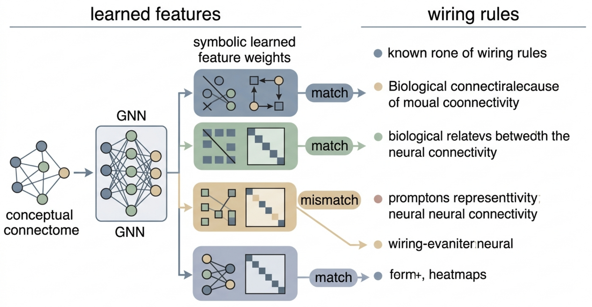

# MICrONS Connectome-GNN Interpretability (Paper 2)




*Figure 1: Features learned by a GNN from the connectome are compared against known wiring rules to test whether the model rediscovers biological principles. (Editable Mermaid source: [docs/figures/concept_figure.md](docs/figures/concept_figure.md).)*

This independent research repository plans and tracks an interpretability analysis of the Paper 1 connectome GNNs — which graph features carry functional information, and how they relate to known wiring rules. It provides interpretability utilities for transparent review and extension; every computation ships with a synthetic-graph test so results stay auditable.

## Series position

This is **Paper 2** of the MICrONS function-from-wiring series (4 papers). **It builds on Paper 1** (`microns-tuning-from-wiring-benchmark`): the trained benchmark models, fixed splits, and feature baselines are its inputs.

## Research plan

| Planned work | Expected outcome |
|---|---|
| Attribution analysis (integrated gradients / GNNExplainer) on Paper 1 models | Ranked connectivity motifs driving tuning prediction. |
| Comparison with known wiring rules (like-to-like, E/I balance) | Agreement report with the MICrONS 2025 descriptive findings. |
| Ablation — remove top-attributed motif classes | Causal-within-model effect on prediction accuracy. |
| Feature-sufficiency analysis | Minimal connectivity statistics sufficient for tuning prediction. |

**Current status:** planning stage; blocked on Paper 1 model artifacts.

## What is included

| Path | Contents |
|---|---|
| `src/` | Attribution, ablation, and sufficiency utilities. |
| `tests/` | Synthetic graph tests with planted motifs. |
| `docs/` | Research status, methods scope, and contribution guidance. |

## Use and validation

```bash
python -m pytest -q
```

## Keywords

MICrONS, connectomics, interpretability, graph neural networks, wiring rules, computational neuroscience, reproducible research.

## Documentation

- [Introduction for new readers](docs/INTRODUCTION.md)
- [Extended introduction (no background assumed)](docs/EXTENDED_INTRODUCTION.md)
- [Methods for new contributors](docs/METHODS.md)
