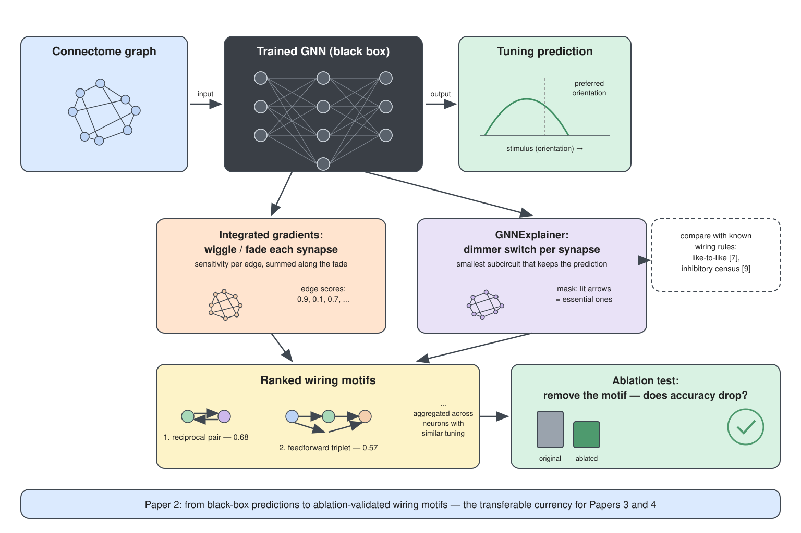
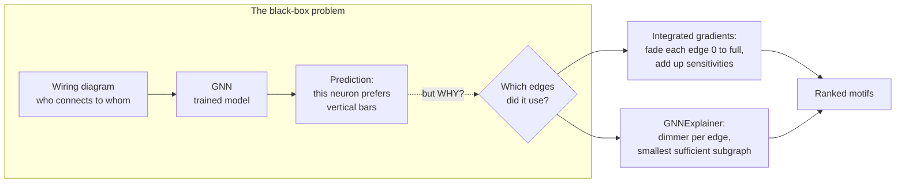
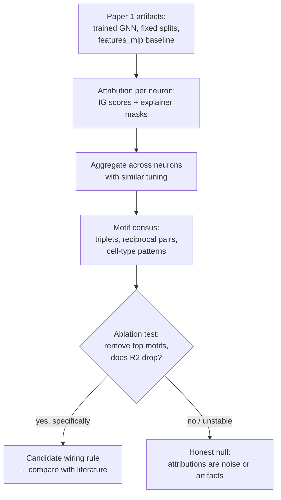
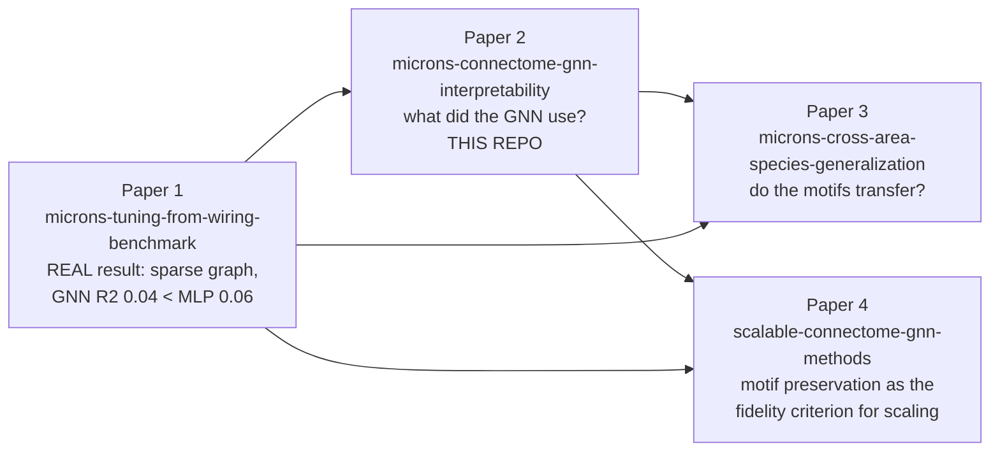

# Extended Introduction — Paper 2: Opening the Black Box of Connectome GNNs

*Figure 1. The Paper 2 pipeline: a trained GNN maps wiring to tuning predictions; two attribution methods (integrated gradients, explainer masks) score every synapse; scores aggregate into ranked motifs that are then tested by ablation and compared with published wiring rules.*

> **Builds on:** Paper 1 (`microns-tuning-from-wiring-benchmark`). Paper 3 (`microns-cross-area-species-generalization`) transfers the motifs we identify, and Paper 4 (`scalable-connectome-gnn-methods`) uses them as a fidelity check. No background in neuroscience or machine learning is assumed — every formal idea is first shown on a tiny wiring diagram you can draw on paper.

## A four-neuron mystery

Draw four dots on paper: A, B, C, D. Draw arrow A → C labeled "3 synapses", B → C labeled "1", and C → D labeled "5". This napkin sketch is a tiny *connectome*: dots are neurons, arrows are synapses. In Paper 1 we built a *graph neural network* (GNN) — a gossip procedure in which each neuron keeps a "note card" of numbers, passes it along arrows weighted by synapse count, and rewrites its card using learned mixing recipes — and trained it to predict each neuron's visual tuning (its favorite pattern, e.g. vertical bars) from the wiring alone [5].

Now suppose our trained model predicts: "neuron D prefers vertical bars." Here is the mystery this paper is built around: **which arrow on the napkin was responsible?** Was it the strong C → D connection? Did the A → C vs. B → C imbalance matter? Or was the model really just reading D's location features and ignoring the arrows entirely? A prediction you cannot trace back to its ingredients is a prediction you cannot turn into biology. Answering "which ingredients did the work?" is called *interpretability*, or opening the black box.

(The everyday version: a cake tastes great, but "it tastes good" doesn't tell you the recipe. Interpretability is figuring out whether the secret was the browned butter or the extra egg yolk.)

## The two-minute primer: what Paper 1 left behind

**The data.** The MICrONS project mapped a cubic millimeter of mouse visual cortex — >200,000 cells, ~523 million synapses — and recorded activity from ~75,000 of the same neurons while the mouse watched visual stimuli [3,4]. For many neurons we know both *who they are wired to* and *what they respond to*.

**The model.** A wiring diagram is a *graph* (nodes and arrows). A GNN learns note-card mixing recipes by *gradient descent*: make a prediction, measure the error, nudge every recipe number slightly downhill, repeat millions of times. If neural networks are new to you, the friendliest introductions are 3Blue1Brown's *Neural Networks* series (https://www.3blue1brown.com/topics/neural-networks) and StatQuest's short lessons (https://statquest.org/video-index/).

**The honest Paper 1 result.** On the coregistered, proofread subgraph — 12,894 neurons but only 8,128 edges (~1.3 arrows per neuron) — the wiring-aware GNN (R² ≈ 0.04) did *not* beat a wiring-free model using only per-neuron features (R² ≈ 0.06), and its score was unchanged when arrows were shuffled while preserving each neuron's arrow count. In plain words: **on the current sparse graph, the GNN is not demonstrably using the wiring.** That is precisely why this paper exists: before anyone trusts a future denser version, we need tools that can tell real wiring signal from reconstruction artifact.

## Attribution method 1: the "wiggle test" (gradient-based attribution)

Back to the napkin. The model says D prefers vertical bars. Try this experiment: *weaken the A → C arrow slightly* — pretend it has 2.9 synapses instead of 3 — and see how much the prediction moves. Then restore it and wiggle B → C instead. The arrow whose wiggle moves the prediction most is, by this test, the most important.

That wiggle is literally what a **gradient** is: the sensitivity of the output to a tiny nudge of one input. Calculus gives us all the wiggles at once, almost for free, without re-running the model by hand. (StatQuest has a gentle explainer of gradients: https://statquest.org/video-index/.)

**Integrated gradients** adds one refinement. A single wiggle can mislead — an arrow might only matter in combination with others, so wiggling it alone does nothing. The fix: instead of one wiggle, *fade the arrow smoothly from fully off (weight 0) to fully on (weight 3)*, take the sensitivity at every brightness level, and add them all up. An arrow that does heavy lifting somewhere along that fade gets a high score.

The formula, then the napkin sentence:

> score(edge) = (x − x₀) · ∫ ∂f/∂x dα — *the total change in the prediction as this connection fades from off to on, accumulated along the whole fade.*

Going back to the cake: it is like leaving out one ingredient at a time, but with calculus — fast, and graded rather than all-or-nothing.

## Attribution method 2: the "dimmer-switch" test (perturbation-based explanation)

GNNExplainer takes the opposite route. Put a **dimmer switch on every arrow** — a dial from 0 (arrow erased) to 1 (arrow fully present). Start with all dials at 1, then let an optimizer turn the dials down, with two competing goals: keep D's prediction the same, but turn as many arrows off as possible. When it finishes, the arrows still glowing near 1 are the ones the model *cannot do without*: the **smallest sufficient subcircuit**.

> **Masked prediction:** ŷ = GNN(A ⊙ M, X), where A is the graph, M is a learned edge mask, and ⊙ means element-wise multiplication.
>
> **Plain sentence:** multiply every arrow by its dimmer setting; train the dimmers so the prediction survives while as many arrows as possible go dark; the ones that must stay lit are the important ones.

The two methods answer the same question with different biases — gradients measure *sensitivity*, masks measure *sufficiency* — so this project uses both and cross-checks them (see `docs/METHODS.md`).

## From scores to science: motifs and ablation

A *motif* is a small recurring wiring pattern — the graph equivalent of a chord. On the napkin you can already see one: A → C and B → C together are a **convergence motif** (two neurons funneling onto one). Other classics:

- **Reciprocal pairs:** A → B and B → A. A two-way conversation.
- **Feedforward triplet:** A → B, B → C, A → C. A signal arrives by both a direct and an indirect route.
- **Like-to-like convergence:** many excitatory inputs onto one neuron from neurons with similar visual preferences — the rule Ding et al. documented in MICrONS [7].
- **Cell-type-specific inhibitory patterns:** mapped in detail by Schneider-Mizell et al. [9].

The plan: run attribution per neuron, aggregate the scores across neurons with similar tuning, and count which motifs are enriched at the top of the ranking. But a ranking is just a claim. The test that makes it evidence is **ablation**: redraw the napkin *without* the top-ranked motif (or with its arrows shuffled among the same neurons, preserving arrow counts) and re-run the model. If removing feedforward triplets collapses the predictions while removing random arrows does not, the triplets were doing real work — a **faithfulness check**: an explanation is only worth trusting if deleting its "important" edges actually hurts.

Why does this matter? Because it converts a statistical model into a *biological hypothesis* that experimentalists can perturb. The fly field showed wiring-constrained models can reproduce real activity [6]; the mouse literature has named specific wiring rules [7,9]. This paper sits at the junction: does a learned model rediscover those named rules on its own, and does it point at new ones?

## Where this paper sits in the series

## Key formulas in one sentence each

- **Importance score (integrated gradients):** score(edge) = (x − x₀) · ∫ ∂f/∂x dα — *how much the prediction changes as we fade this connection from off to on, accumulated along the whole fade.*
- **Edge mask (GNNExplainer-style):** minimize over masks M the prediction error of GNN(A ⊙ M) plus a penalty on ‖M‖₁ — *keep the prediction, pay a cost for every arrow you keep lit.*
- **R² (coefficient of determination):** 1 − (model's error)/(error of always predicting the mean) — *fraction of the variation in tuning the model explains; 0 means "no better than guessing the average."* (Interactive intuition: Seeing Theory, https://seeing-theory.brown.edu/)
- **Faithfulness check:** correlation between attribution rank and the accuracy drop when edges are removed in that order — *trust an explanation only if deleting its "important" arrows hurts.*

## What success looks like

Success is not necessarily a big number. Given Paper 1's negative result on the sparse graph, an equally valuable outcome is a *clean explanation of the negative result*: showing the GNN's attributions are diffuse, unstable across seeds, and no worse on rewired graphs — i.e., that there was little wiring signal to find at ~1.3 edges per neuron. That clears the runway for Paper 4's dense-graph scaling and hands Paper 3 an honest, ablation-validated motif set to carry across areas and species.

## References

[1] White et al., *C. elegans* connectome, Phil. Trans. R. Soc. B 314 (1986). DOI: 10.1098/rstb.1986.0056
[2] Dorkenwald et al., FlyWire adult fly brain, Nature 634 (2024). DOI: 10.1038/s41586-024-07558-y
[3] MICrONS Consortium, Functional connectomics spanning multiple areas of mouse visual cortex, Nature 640 (2025). DOI: 10.1038/s41586-025-08790-w
[4] Turner et al., Reconstruction of neocortex, Cell 185 (2022). DOI: 10.1016/j.cell.2022.01.023
[5] Kipf & Welling, GCN, ICLR 2017. arXiv:1609.02907
[6] Lappalainen et al., Connectome-constrained networks predict fly visual activity, Nature 634 (2024). DOI: 10.1038/s41586-024-07939-3
[7] Ding et al., General wiring rule in mouse visual cortex (like-to-like), Nature 640 (2025). DOI: 10.1038/s41586-025-08840-3
[8] Bashivan et al., Neural population control via deep image synthesis, Science 364 (2019). DOI: 10.1126/science.aav9436
[9] Schneider-Mizell et al., Inhibitory specificity from a connectomic census, Nature 640 (2025). DOI: 10.1038/s41586-024-07780-8

*Explainer resources (not citations): StatQuest — https://statquest.org/video-index/ · 3Blue1Brown Neural Networks — https://www.3blue1brown.com/topics/neural-networks · Seeing Theory — https://seeing-theory.brown.edu/*
