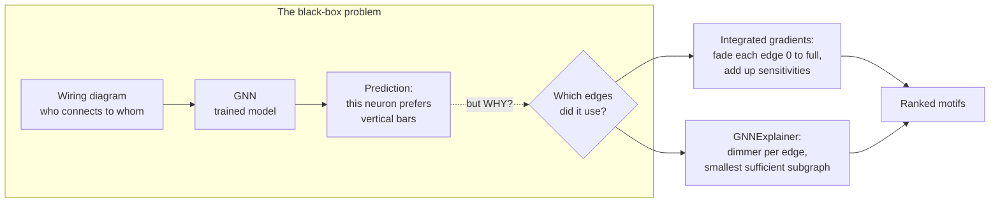
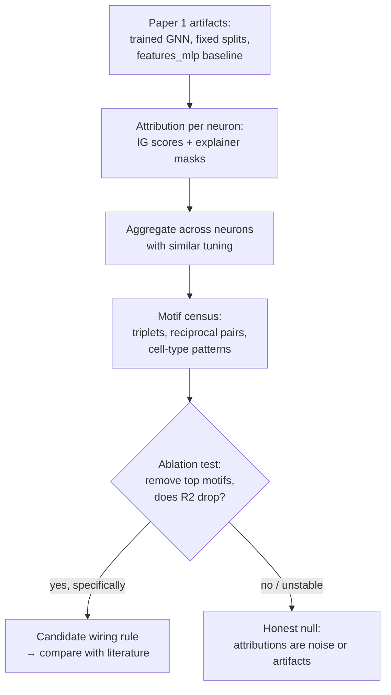
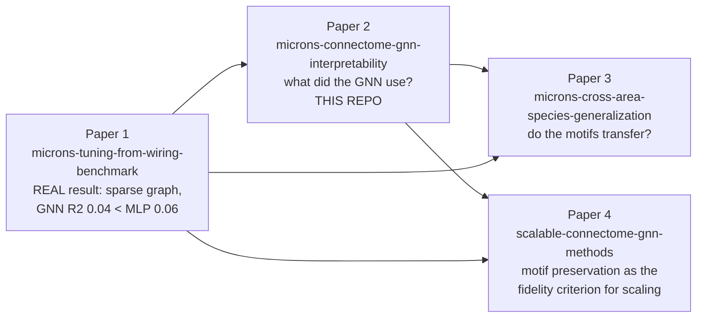

# Extended Introduction — Paper 2: Opening the Black Box of Connectome GNNs


*Figure 1. The Paper 2 pipeline: a trained GNN maps wiring to tuning predictions; two attribution methods (integrated gradients, explainer masks) score every synapse; scores aggregate into ranked motifs that are then tested by ablation and compared with published wiring rules.*

> **Builds on:** Paper 1 (`microns-tuning-from-wiring-benchmark`). Paper 3 (`microns-cross-area-species-generalization`) transfers the motifs we identify, and Paper 4 (`scalable-connectome-gnn-methods`) uses them as a fidelity check. No background in neuroscience or machine learning is assumed — every formal idea is first shown on a tiny wiring diagram you can draw on paper.

## Start here: the math toolkit from zero

Every symbol used later in this document is defined here in plain words, with a tiny numeric example. Nothing below assumes any math background. Come back whenever a symbol looks unfamiliar.

- **Vector.** A short list of numbers in a fixed order, like $`(0.30, 0.02, 0.70)`$ — one number per edge. The "importance vector" below is exactly such a list.
- **Matrix.** A table of numbers with rows and columns — a spreadsheet. The adjacency matrix $`A`$ of a wiring diagram has one row and one column per neuron, with the synapse count in each cell.
- **Sum (Σ).** $`\sum`$ means "add these up": $`\sum_j w_j`$ over weights $`(3, 1)`$ is $`3 + 1 = 4`$. A **weighted sum** multiplies each item first: $`3 \cdot 1 + 1 \cdot 1 = 4`$.
- **Probability (as a fraction).** A count divided by a total, between 0 and 1. *Example:* 14 of 20 neurons break after ablation: $`14/20 = 0.7`$.
- **Expectation (average).** $`\mathbb{E}[x]`$ or $`\bar{x}`$ is the ordinary average: add up, divide by count. *Example:* average of $`(0.5, 0.1, 0.3, 0.9)`$ is $`0.45`$.
- **Log₂ and bits.** $`\log_2(n)`$ is "how many yes/no questions pin down one of $`n`$ options": $`\log_2(8) = 3`$. Entropy, $`H = -\sum_i p_i \log_2 p_i`$, is the average number of questions a random quantity carries; a fair coin has 1 bit.
- **Graph.** $`G = (V, E)`$: nodes $`V`$, arrows $`E`$, optionally with weights. *Example:* $`V = \{A,B,C,D\}`$, $`E = \{A\to C, B\to C, C\to D\}`$ is the napkin used throughout.
- **Gradient (∂f/∂x).** The gradient $`\partial f / \partial x`$ is the answer to "if I nudge input $`x`$ by a tiny amount, how much does the output move?" *Example:* if lowering weight 3 → 2.9 moves the prediction by 0.03, the gradient there is about $`0.03/0.1 = 0.3`$.
- **Integral (∫).** $`\int_0^1 g(\alpha)\, d\alpha`$ means "add up the value of $`g`$ at every point of a smooth fade from 0 to 1". Think of 100 wiggle measurements averaged together — that sum is the integral.
- **Element-wise product (⊙).** $`A \odot M`$ multiplies two tables cell by cell: if $`A`$ holds arrow weights $`(3, 1, 5)`$ and $`M`$ holds dimmer settings $`(1, 0, 1)`$, the result is $`(3, 0, 5)`$ — the second arrow is switched off.
- **L1 norm (‖M‖₁).** $`\lVert M \rVert_1`$ is the sum of the dial settings: for $`M = (1, 0, 1)`$ it is $`2`$. It counts "how many arrows are still lit", which is why it works as a parsimony penalty.
- **R².** $`R^2 = 1 - \frac{\text{model's squared errors}}{\text{squared errors of guessing the average}}`$; model errors 0.03 vs. lazy 0.35 give $`R^2 \approx 0.91`$, and 0 means "no better than the average".
- **Correlation.** A number in $`[-1, 1]`$ for "two lists rise and fall together": predictions $`(0.4,0.2,0.3,0.8)`$ vs. truths $`(0.5,0.1,0.3,0.9)`$ give $`r`$ near $`+1`$.

## A four-neuron mystery

Draw four dots on paper: A, B, C, D. Draw arrow A → C labeled "3 synapses", B → C labeled "1", and C → D labeled "5". This napkin sketch is a tiny *connectome*: dots are neurons, arrows are synapses. In Paper 1 we built a *graph neural network* (GNN) — a gossip procedure in which each neuron keeps a "note card" of numbers, passes it along arrows weighted by synapse count, and rewrites its card using learned mixing recipes — and trained it to predict each neuron's visual tuning (its favorite pattern, e.g. vertical bars) from the wiring alone [5].

Now suppose our trained model predicts: "neuron D prefers vertical bars." Here is the mystery this paper is built around: **which arrow on the napkin was responsible?** Was it the strong C → D connection? Did the A → C vs. B → C imbalance matter? Or was the model really just reading D's location features and ignoring the arrows entirely? A prediction you cannot trace back to its ingredients is a prediction you cannot turn into biology. Answering "which ingredients did the work?" is called *interpretability*, or opening the black box.

(The everyday version: a cake tastes great, but "it tastes good" doesn't tell you the recipe. Interpretability is figuring out whether the secret was the browned butter or the extra egg yolk.)

## The two-minute primer: what Paper 1 left behind

**The data.** The MICrONS project mapped a cubic millimeter of mouse visual cortex — >200,000 cells, ~523 million synapses — and recorded activity from ~75,000 of the same neurons while the mouse watched visual stimuli [3,4]. For many neurons we know both *who they are wired to* and *what they respond to*.

**The model.** A wiring diagram is a *graph* (nodes and arrows). A GNN learns note-card mixing recipes by *gradient descent*: make a prediction, measure the error, nudge every recipe number slightly downhill, repeat millions of times. If neural networks are new to you, the friendliest introductions are 3Blue1Brown's *Neural Networks* series (https://www.3blue1brown.com/topics/neural-networks) and StatQuest's short lessons (https://statquest.org/video-index/).

**The honest Paper 1 result.** On the coregistered, proofread subgraph — 12,894 neurons but only 8,128 edges (~1.3 arrows per neuron) — the wiring-aware GNN (R² ≈ 0.04) did *not* beat a wiring-free model using only per-neuron features (R² ≈ 0.06), and its score was unchanged when arrows were shuffled while preserving each neuron's arrow count. In plain words: **on the current sparse graph, the GNN is not demonstrably using the wiring.** That is precisely why this paper exists: before anyone trusts a future denser version, we need tools that can tell real wiring signal from reconstruction artifact.

## Attribution method 1: the "wiggle test" (gradient-based attribution)

Back to the napkin. The model says D prefers vertical bars. Try this experiment: *weaken the A → C arrow slightly* — pretend it has 2.9 synapses instead of 3 — and see how much the prediction moves. Then restore it and wiggle B → C instead. The arrow whose wiggle moves the prediction most is, by this test, the most important.

That wiggle is literally what a **gradient** is: the sensitivity of the output to a tiny nudge of one input. Calculus gives us all the wiggles at once, almost for free, without re-running the model by hand. (StatQuest has a gentle explainer of gradients: https://statquest.org/video-index/.)

**Integrated gradients** adds one refinement. A single wiggle can mislead — an arrow might only matter in combination with others, so wiggling it alone does nothing. The fix: instead of one wiggle, *fade the arrow smoothly from fully off (weight 0) to fully on (weight 3)*, take the sensitivity at every brightness level, and add them all up. An arrow that does heavy lifting somewhere along that fade gets a high score.

The formula, then the napkin sentence:

> score(edge) = (x − x₀) · ∫ ∂f/∂x dα — *the total change in the prediction as this connection fades from off to on, accumulated along the whole fade.*

In rendered LaTeX, the identical statement:

```math
\mathrm{score}(e) = (x - x_0) \int_0^1 \frac{\partial f\big(\alpha \cdot x\big)}{\partial x}\, d\alpha
```

*Tiny-number check:* if fading edge C→D from 0 to 5 sweeps up sensitivity worth 0.70 of prediction movement (Road 1's erasure experiment), the integral's job is to recover that 0.70 as an accumulated sum over the fade.

Going back to the cake: it is like leaving out one ingredient at a time, but with calculus — fast, and graded rather than all-or-nothing.

### The many roads to attribution

"Which arrow did the work?" can be answered without any calculus at all. Three roads:

**Road 1: finite differences (counting wiggles, no calculus).** A gradient is only a *tiny* wiggle; nothing stops you from using a *whole-sized* wiggle and simply measuring the difference. *Worked example:* suppose the model's predicted OSI for D is 0.80 with the napkin intact. Erase A → C entirely (weight 3 → 0): prediction drops to 0.50, a difference of 0.30. Erase B → C (1 → 0): prediction moves to 0.78, a difference of 0.02. Erase C → D (5 → 0): 0.10, a difference of 0.70. Ranking by raw difference: C → D (0.70) > A → C (0.30) > B → C (0.02). You have just produced an attribution ranking with subtraction alone — this is exactly the ablation logic the paper ends with, used as the *definition* of importance rather than merely its check. *What this road buys you:* zero machinery beyond re-running the model, and the answer is in units of the prediction itself. *What it costs you:* one wiggle at a time misses teamwork — if A → C only matters when B → C is also present, neither single erasure shows it; you must test pairs (3 pairs on this napkin: AB, AC... in edge terms, 3 choose 2 = 3 joint erasures), and the count of subsets grows as 2^(edges).

**Road 2: information theory by counting (which edge answers the most questions).** Before any attribution, the prediction could in principle depend on any of the 3 arrows — log2(3) ≈ 1.6 questions of uncertainty about "where the answer comes from". *Worked example:* from Road 1's wiggles, C → D alone changes the prediction by 0.70 of the total 1.02 movement (0.30 + 0.02 + 0.70), i.e. 69% of all the explainable movement; A → C carries 29%; B → C carries 2%. Saying "C → D did it" answers about log2(1/0.69) ≈ 0.5 questions by itself, and the top two edges together cover 98% of the movement — nearly the whole question budget. Integrated gradients' "accumulate along the fade" is this same accounting with finer-grained wiggles. *What this road buys you:* attribution becomes a budget that must sum to 100%, so double-counting and missing credit are visible immediately. *What it costs you:* percentages of movement assume the wiggles add up cleanly; with strong interactions (edges that only matter together) the budget does not partition, and the method tells you so by failing to sum to 100%.

**Road 3: geometry (importance as a direction).** Collect the three wiggle-differences into a point: (0.30, 0.02, 0.70) in "edge space". *Worked example:* the length of this point is sqrt(0.30² + 0.02² + 0.70²) = sqrt(0.09 + 0.0004 + 0.49) ≈ 0.76, i.e. $`\lVert v \rVert = \sqrt{\textstyle\sum_i v_i^2} = \sqrt{0.30^2 + 0.02^2 + 0.70^2} \approx 0.76,`$ exactly the arithmetic just done, and the C → D axis contributes 0.70/0.76 ≈ 92% of the length — the importance vector points almost purely along one axis. Two neurons whose importance vectors point the same way "used the same circuit"; clustering neurons becomes clustering arrows-on-the-compass. *What this road buys you:* attributions across thousands of neurons become points you can compare, rotate, and cluster — the actual aggregation step of this paper. *What it costs you:* distances in edge-space treat all edges as comparable units, which biology may not endorse (a weak inhibitory arrow and a strong excitatory one are not interchangeable).

## Attribution method 2: the "dimmer-switch" test (perturbation-based explanation)

GNNExplainer takes the opposite route. Put a **dimmer switch on every arrow** — a dial from 0 (arrow erased) to 1 (arrow fully present). Start with all dials at 1, then let an optimizer turn the dials down, with two competing goals: keep D's prediction the same, but turn as many arrows off as possible. When it finishes, the arrows still glowing near 1 are the ones the model *cannot do without*: the **smallest sufficient subcircuit**.

> **Masked prediction:** ŷ = GNN(A ⊙ M, X), where A is the graph, M is a learned edge mask, and ⊙ means element-wise multiplication.
>
> **Plain sentence:** multiply every arrow by its dimmer setting; train the dimmers so the prediction survives while as many arrows as possible go dark; the ones that must stay lit are the important ones.

In rendered LaTeX, with the training objective spelled out:

```math
\hat{y} = \mathrm{GNN}(A \odot M,\, X), \qquad \min_{M}\; \mathcal{L}(\hat{y}, y) + \lambda \, \lVert M \rVert_1
```

*Tiny-number check:* for napkin weights $`(3, 1, 5)`$ and dial settings $`M = (1, 0, 1)`$, $`A \odot M = (3, 0, 5)`$ and $`\lVert M \rVert_1 = 2`$ — the prediction runs on two arrows, and the penalty charges 2 for them.

The two methods answer the same question with different biases — gradients measure *sensitivity*, masks measure *sufficiency* — so this project uses both and cross-checks them (see `docs/METHODS.md`).

### The many roads to sufficiency (the dimmer-switch mask)

GNNExplainer's "smallest sufficient subcircuit" is one idea with several formal doors.

**Road 1: set theory (the minimal sufficient subset).** Forget dials; think subsets. The edge set is E = {A→C, B→C, C→D}; a subset S ⊆ E is *sufficient* if the model restricted to S still predicts D well. *Worked example:* test all 7 nonempty subsets by re-running the model. Suppose {C→D} alone gives prediction 0.75 (target 0.80, within tolerance 0.1), {A→C} alone gives 0.10, and {B→C} alone gives 0.40. Then the smallest sufficient subset is {C→D}, size 1: one arrow suffices, the rest is decoration. The explainer's optimization is just a fast search through this subset lattice. *What this road buys you:* "sufficient" becomes a checkable property of a set, and "smallest" means minimal by inclusion — no other sufficient set strictly inside it. *What it costs you:* 2^|E| subsets explode (7 on the napkin, astronomical on 8,128 edges), which is exactly why the continuous dimmer-switch relaxation was invented.

**Road 2: game theory as best response (two players tugging the dials).** Picture two players sharing the dimmer board. Player Fidelity wins when the prediction stays near 0.80; player Parsimony wins when dials go dark. Each adjusts in turn — a best-response dynamic. *Worked example:* start all dials at 1. Parsimony turns B → C to 0; Fidelity checks: prediction still 0.79, fine, no move. Parsimony turns A → C to 0: prediction 0.50; Fidelity "responds" by demanding A → C back at 1 (restoring 0.80). Parsimony tries C → D at 0: prediction collapses to 0.10; Fidelity vetoes. No player can improve unilaterally: dials at (A→C: 1, B→C: 0, C→D: 1) — a stable point, in the Nash-flavored sense, and the surviving lit arrows are the explanation. *What this road buys you:* the penalty term ‖M‖₁ stops being mysterious — it is Parsimony's score — and "convergence" means nobody wants to move. *What it costs you:* the metaphor hides that both players are really one optimizer trading off two terms; stable points can be local, so different random starts can light different arrows.

**Road 3: automata (the model as a transition table with some rows deleted).** View the trained GNN on the napkin as a fixed machine: input = the cards, transition = one gossip round, output = D's prediction. Erasing an arrow deletes rows from the machine's wiring table. *Worked example:* the machine's "C-step" reads rows (A→C, 3) and (B→C, 1). Delete the second row and the machine still computes C ≈ 3·card(A); delete the first and C ≈ 1·card(B) — a different, weaker machine. Asking "which rows can I delete before the output changes beyond tolerance?" is a question about the *table*, answerable by exhaustive deletion on small machines. *What this road buys you:* interpretability becomes program analysis — you are reading and pruning the machine's instruction list. *What it costs you:* the learned recipes are shared across all neurons, so "deleting a row" is cleaner on the napkin than on the real network, where one learned weight serves millions of edges.

## From scores to science: motifs and ablation

A *motif* is a small recurring wiring pattern — the graph equivalent of a chord. On the napkin you can already see one: A → C and B → C together are a **convergence motif** (two neurons funneling onto one). Other classics:

- **Reciprocal pairs:** A → B and B → A. A two-way conversation.
- **Feedforward triplet:** A → B, B → C, A → C. A signal arrives by both a direct and an indirect route.
- **Like-to-like convergence:** many excitatory inputs onto one neuron from neurons with similar visual preferences — the rule Ding et al. documented in MICrONS [7].
- **Cell-type-specific inhibitory patterns:** mapped in detail by Schneider-Mizell et al. [9].

### The many roads to motifs

A motif is "a small recurring wiring pattern", and each road below tells you what *recurring* means.

**Road 1: graph theory (counting by hand).** A motif census is literal counting. *Worked example:* our napkin has edges A→C, B→C, C→D. Count convergence motifs (two arrows into one node): C receives from A and B — that is 1. Count reciprocal pairs (X→Y and Y→X): 0. Count feedforward triplets (X→Y, Y→Z, X→Z): we have A→C, C→D but no A→D, so 0. The census of the napkin is the count vector (convergence: 1, reciprocal: 0, triplet: 0). "Enrichment" asks whether real counts exceed chance: there are 4·3 = 12 possible arrows on 4 nodes, the napkin uses 3, and the chance of a convergence at C by luck is computable from those counts. *What this road buys you:* motif claims become auditable integer counts with an explicit chance model. *What it costs you:* the chance model ("random graph with the same degrees") is a choice, and different choices flip enrichment verdicts — Paper 1's degree-preserving null is one such choice.

**Road 2: category-flavored composition (motifs as commuting diagrams).** A feedforward triplet is the statement "the direct road X→Z and the composed road X→Y→Z have the same start and destination" — two routes, one pair of endpoints. *Worked example:* add the arrow A→D to the napkin. Now A reaches D two ways: directly, and composed through C. The diagram "commutes" in the loose sense that both paths exist; the motif count of such two-road patterns is exactly the triplet count of Road 1, now phrased as *compositions that close a diagram*. Like-to-like wiring (Ding et al. [7]) becomes: the composed road tends to land where the direct road already lands, among neurons with matching tuning. *What this road buys you:* "motif" stops being a picture and becomes a compositional fact, which is what makes motifs transferable across areas and species in Paper 3 — composition is defined the same way on every napkin. *What it costs you:* this road says nothing about strength; a 1-synapse arrow and a 50-synapse arrow compose identically until weights are reattached.

**Road 3: probability as frequencies (ablation as a 2×2 table).** "Was the motif doing real work?" is answerable by counting outcomes. *Worked example:* ablate the top-ranked motif in 20 held-out neurons and ablate random arrows in 20 others; count how often the prediction breaks (say, error more than doubling). Results: motif-ablated 14 broken / 6 fine; random-ablated 3 broken / 17 fine. The 2×2 table (14, 6, 3, 17) says breaking is concentrated in the motif condition — 14/20 versus 3/20 — and the faithfulness check is the correlation version of exactly this table across all edges. *What this road buys you:* "the explanation is faithful" becomes a contingency table a skeptical biologist can audit row by row. *What it costs you:* the table counts breaks, not causes — a broken prediction after ablation shows the motif was *load-bearing in this model*, which is evidence about the biology only as far as the model is trusted.

The plan: run attribution per neuron, aggregate the scores across neurons with similar tuning, and count which motifs are enriched at the top of the ranking. But a ranking is just a claim. The test that makes it evidence is **ablation**: redraw the napkin *without* the top-ranked motif (or with its arrows shuffled among the same neurons, preserving arrow counts) and re-run the model. If removing feedforward triplets collapses the predictions while removing random arrows does not, the triplets were doing real work — a **faithfulness check**: an explanation is only worth trusting if deleting its "important" edges actually hurts.

Why does this matter? Because it converts a statistical model into a *biological hypothesis* that experimentalists can perturb. The fly field showed wiring-constrained models can reproduce real activity [6]; the mouse literature has named specific wiring rules [7,9]. This paper sits at the junction: does a learned model rediscover those named rules on its own, and does it point at new ones?





## Where this paper sits in the series



## Key formulas in one sentence each

- **Importance score (integrated gradients):** score(edge) = (x − x₀) · ∫ ∂f/∂x dα — *how much the prediction changes as we fade this connection from off to on, accumulated along the whole fade.*
- **Edge mask (GNNExplainer-style):** minimize over masks M the prediction error of GNN(A ⊙ M) plus a penalty on ‖M‖₁ — *keep the prediction, pay a cost for every arrow you keep lit.*
- **R² (coefficient of determination):** 1 − (model's error)/(error of always predicting the mean) In symbols: $`R^2 = 1 - \frac{\sum_i (y_i - \hat{y}_i)^2}{\sum_i (y_i - \bar{y})^2}`$ — with the napkin numbers, $`1 - 0.03/0.35 \approx 0.91`$. — *fraction of the variation in tuning the model explains; 0 means "no better than guessing the average."* (Interactive intuition: Seeing Theory, https://seeing-theory.brown.edu/)
- **Faithfulness check:** correlation between attribution rank and the accuracy drop when edges are removed in that order — *trust an explanation only if deleting its "important" arrows hurts.*

## What success looks like

Success is not necessarily a big number. Given Paper 1's negative result on the sparse graph, an equally valuable outcome is a *clean explanation of the negative result*: showing the GNN's attributions are diffuse, unstable across seeds, and no worse on rewired graphs — i.e., that there was little wiring signal to find at ~1.3 edges per neuron. That clears the runway for Paper 4's dense-graph scaling and hands Paper 3 an honest, ablation-validated motif set to carry across areas and species.

## Choosing your road

Every core idea above has several doors; one per idea is enough. If you think in experiments, take the finite-difference and ablation roads — attribution by erasing things and counting what breaks. If you think in questions and budgets, take the information-by-counting road, where importance is a percentage of explainable movement. If you think in sets, the minimal-sufficient-subset road defines the explainer mask without a single dial. If you think in negotiations, the two-player best-response road explains what the mask's penalty term is doing and what "converged" means. If you think in pictures, the geometry road turns attribution vectors into compass directions you can cluster. And if you think in diagrams of arrows, the graph-counting and composition roads make motifs — and their transfer to Paper 3 — purely about which roads share a destination. All roads converge on this paper's discipline: an explanation counts only if deleting what it names actually hurts.

## Learn more (verified links)

Each link was checked to load and match the topic.

**Graph theory and GNNs**
- [Graph theory (Wikipedia)](https://en.wikipedia.org/wiki/Graph_theory) — nodes, edges, subgraphs, and motifs: the formal vocabulary behind every napkin census here.
- [Kipf & Welling, GCN (arXiv:1609.02907)](https://arxiv.org/abs/1609.02907) — the foundational graph-convolution paper whose message-passing layer is the black box this paper opens.

**Neural networks and gradients**
- [3Blue1Brown: Neural Networks](https://www.3blue1brown.com/topics/neural-networks) — visual episodes on gradient descent and backpropagation, which is what makes integrated gradients computable at all.
- [StatQuest video index](https://statquest.org/video-index/) — short lessons on gradients, R-squared, and entropy, all load-bearing concepts in this paper.

**R² and evaluation**
- [Coefficient of determination (Wikipedia)](https://en.wikipedia.org/wiki/Coefficient_of_determination) — the formal definition and interpretation of the R² used in every ablation check.

**Information theory**
- [Entropy (information theory) (Wikipedia)](https://en.wikipedia.org/wiki/Entropy_(information_theory)) — Shannon entropy and the log₂ question-counting used in the "which edge answers the most questions" road.

**Negative results in science**
- [Null result (Wikipedia)](https://en.wikipedia.org/wiki/Null_result) — why a clean explanation of a *negative* result (diffuse, unstable attributions) counts as success here.

## References

[1] White et al., *C. elegans* connectome, Phil. Trans. R. Soc. B 314 (1986). DOI: 10.1098/rstb.1986.0056
[2] Dorkenwald et al., FlyWire adult fly brain, Nature 634 (2024). DOI: 10.1038/s41586-024-07558-y
[3] MICrONS Consortium, Functional connectomics spanning multiple areas of mouse visual cortex, Nature 640 (2025). DOI: 10.1038/s41586-025-08790-w
[4] Turner et al., Reconstruction of neocortex, Cell 185 (2022). DOI: 10.1016/j.cell.2022.01.023
[5] Kipf & Welling, GCN, ICLR 2017. arXiv:1609.02907
[6] Lappalainen et al., Connectome-constrained networks predict fly visual activity, Nature 634 (2024). DOI: 10.1038/s41586-024-07939-3
[7] Ding et al., General wiring rule in mouse visual cortex (like-to-like), Nature 640 (2025). DOI: 10.1038/s41586-025-08840-3
[8] Bashivan et al., Neural population control via deep image synthesis, Science 364 (2019). DOI: 10.1126/science.aav9436
[9] Schneider-Mizell et al., Inhibitory specificity from a connectomic census, Nature 640 (2025). DOI: 10.1038/s41586-024-07780-8

*Explainer resources (not citations): StatQuest — https://statquest.org/video-index/ · 3Blue1Brown Neural Networks — https://www.3blue1brown.com/topics/neural-networks · Seeing Theory — https://seeing-theory.brown.edu/*
