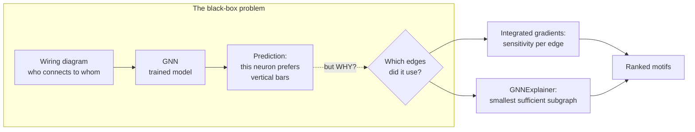
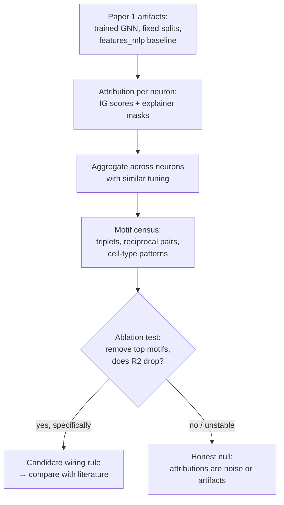
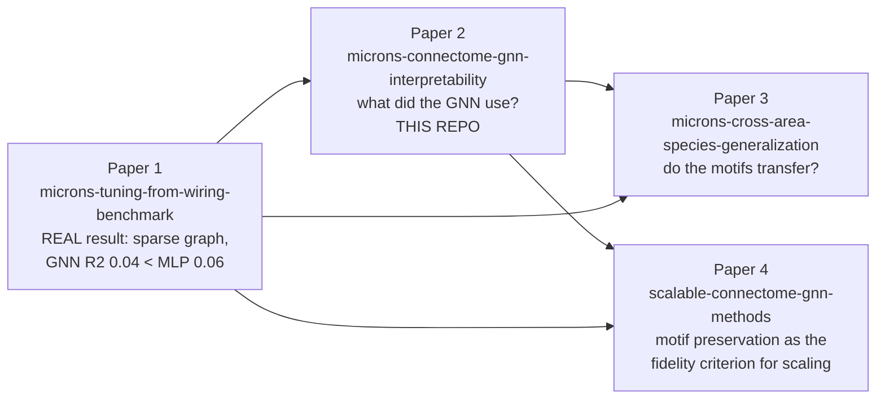

# Extended Introduction — Paper 2: Opening the Black Box of Connectome GNNs

> **Builds on:** Paper 1 (`microns-tuning-from-wiring-benchmark`). Later papers reuse this paper's outputs: Paper 3 (`microns-cross-area-species-generalization`) transfers the motifs we identify, and Paper 4 (`scalable-connectome-gnn-methods`) uses them as a fidelity check. No background in neuroscience or machine learning is assumed — every idea is explained from scratch.

## The cake analogy: tasting good is not the same as knowing the recipe

Imagine someone bakes you a cake and it tastes wonderful. You can *verify* that it tastes good — take a bite, done. But suppose you need to bake it yourself, or you suspect the secret is one unusual ingredient. Now "it tastes good" is useless. You need to know **which ingredient did the work**: was it the browned butter, the pinch of salt, the extra egg yolk?

A trained machine-learning model is like that cake. Paper 1 of this series trained a model that takes the *wiring diagram* of a piece of mouse visual cortex — a list of which neuron connects to which — and tries to predict what each neuron *does* (for example, which direction of motion it prefers). The model's score tells us "the cake tastes this good." This paper asks: **which ingredients — which specific connections in the wiring — did the model actually use?** That question is called *interpretability*, or "opening the black box."

## The two-minute neuroscience and ML primer

**Neurons and wiring.** Your brain is made of cells called neurons. Neurons talk to each other through connection points called *synapses*. If you map every neuron and every synapse in a piece of brain, you get a *connectome*: a wiring diagram. The MICrONS project produced such a diagram for a cubic millimeter of mouse visual cortex — over 200,000 cells and roughly half a billion synapses — and, crucially, also recorded the activity of about 75,000 of those same neurons while the mouse watched visual stimuli [3,4]. So for many neurons we know both *who they are wired to* and *what they respond to*.

**Graphs and GNNs.** Mathematically, a wiring diagram is a *graph*: neurons are nodes, synapses are edges. A *graph neural network* (GNN) is a learning algorithm built for graphs [5]. The basic move is called *message passing*: each neuron-node collects information from its direct neighbors, mixes it with its own information, and updates; repeat a few times and each node ends up knowing about its wider neighborhood. Finally the GNN makes a prediction per node — here, a prediction of the neuron's visual tuning. If you have never seen a neural network, the 3Blue1Brown video series *Neural Networks* (https://www.youtube.com/playlist?list=PLZHQObOWTQDNU6R1_67000Dx_ZCJB-3pi) is the friendliest visual introduction; StatQuest's *Neural Networks* playlist (https://statquest.org/video-index/) covers the same ground in short lessons.

**The Paper 1 result that motivates everything here.** Paper 1 did this experiment honestly, with 12,894 neurons that had both wiring and activity data, connected by 8,128 proofread edges — a *sparse* graph, about 1.3 edges per neuron. The headline was a **negative result**: the GNN scored R² ≈ 0.04, while a much simpler model that ignores wiring entirely (a plain per-neuron feature model, `features_mlp`) scored R² ≈ 0.06 — slightly *better*. And when the graph edges were shuffled in a way that preserves each neuron's number of connections (a "degree-preserving rewired null"), the GNN's score did not change. In plain words: **on the current sparse graph, the GNN is not demonstrably using the wiring at all.**

That is not a failure of the project — it is the *reason this paper exists*. If the GNN isn't beating a wiring-free baseline, we must find out what it actually relies on before anyone trusts a future, larger version. And if a later, denser graph does produce strong predictions, we will need the same tools to check that the signal is real biology (like the known rule that excitatory neurons wire to neurons with similar responses [7]) rather than a reconstruction artifact.

## What interpretability means, concretely

Interpretability methods are ways of interrogating a trained model. Two families matter here:

**1. Gradient-based attribution (e.g., integrated gradients).** A *gradient* is just a measure of sensitivity: "if I nudge this input a tiny bit, how much does the prediction move?" StatQuest has a gentle explainer of gradients and gradient descent (https://statquest.org/video-index/). Integrated gradients asks this question repeatedly along a path from a blanked-out input to the real input, and adds up the sensitivities. The output is a per-input importance score — here, a score for each *edge* (synapse) saying how much that connection mattered for this prediction. Going back to the cake: it is like systematically leaving out one ingredient at a time, but done with calculus so it is fast and graded rather than all-or-nothing.

**2. Perturbation-based explanation (e.g., GNNExplainer).** GNNExplainer takes the opposite route: it searches for the *smallest* subset of edges that, kept alone, still produces (almost) the same prediction for a given neuron. It learns a soft on/off *mask* over edges — think of a dimmer switch per connection — and turns the dials until only the essential connections are lit. The formula at the heart of it is the masking idea:

> **Masked prediction:** ŷ = GNN(A ⊙ M, X), where A is the graph, M is a learned edge mask, and ⊙ means element-wise multiplication.
>
> **Plain sentence:** we multiply every connection by a learned number between 0 and 1, and we train those numbers so that the prediction stays the same while as many connections as possible are dialed to zero — the ones that must stay near 1 are the important ones.

Both methods answer "what did the model use?", but with different biases — gradients measure local sensitivity, masks measure sufficiency — which is why this project plans to use both and cross-check them (see `docs/METHODS.md`).

## Why synaptic motifs are the scientific prize

A *motif* is a small, recurring wiring pattern — the graph equivalent of a chord in music. Examples:

- **Reciprocal pairs:** neuron A connects to B and B connects back to A. A two-way conversation.
- **Triplets:** three neurons with a characteristic pattern, e.g., A→B, B→C, A→C (a "feedforward loop") or A→B, B→C, C→A (a cycle).
- **Like-to-like convergence:** many excitatory inputs onto one neuron coming from neurons with similar visual preferences — the rule Ding et al. documented directly in the MICrONS data [7].
- **Cell-type-specific inhibitory patterns:** inhibitory interneurons come in types that target different partners, mapped in detail by Schneider-Mizell et al. [9].

Why would discovering that the GNN relies on a particular motif matter? Because it converts a statistical model into a *biological hypothesis*. If the model's predictions collapse when you remove feedforward triplets but not when you remove random edges, then feedforward triplets carry functional information — and an experimentalist can go test that. The fly field has already shown that wiring-constrained models can reproduce real neural activity [6], and the mouse literature has named specific wiring rules [7,9]; this paper sits exactly at the junction: it checks whether a learned model rediscovers those named rules on its own, and whether it points at new ones.

## Where this paper sits in the series

## Key formulas in one sentence each

- **Importance score (integrated gradients):** score(edge) = (x − x₀) · ∫ ∂f/∂x dα — *how much the prediction changes as we fade this connection from off to on, accumulated along the whole fade.* (Background on gradients: StatQuest, https://statquest.org/video-index/; on neural networks: 3Blue1Brown, https://www.3blue1brown.com/topics/neural-networks)
- **Edge mask (GNNExplainer-style):** minimize over masks M the prediction error of GNN(A ⊙ M) plus a penalty on ‖M‖₁ — *keep the prediction, pay a cost for every connection you keep turned on.*
- **R² (coefficient of determination):** 1 − (error of model)/(error of predicting the mean) — *the fraction of the variation in neuronal tuning the model explains; 0 means "no better than guessing the average."* (Interactive intuition: Seeing Theory, https://seeing-theory.brown.edu/)
- **Faithfulness check:** correlation between attribution rank and accuracy drop when edges are removed in that order — *an explanation is only worth trusting if deleting its "important" edges actually hurts.*

## What success looks like

Success is not necessarily a big number. Given Paper 1's negative result on the sparse graph, an equally valuable outcome is a *clean explanation of the negative result*: showing that the GNN's attributions are diffuse, unstable across seeds, and no worse on a rewired graph — i.e., that there was little wiring signal to find at ~1.3 edges per neuron. That clears the runway for Paper 4's dense-graph scaling and gives Paper 3 an honest, ablation-validated motif set to carry across areas and species.

## References

[1] White et al., *C. elegans* connectome, Phil. Trans. R. Soc. B 314 (1986). DOI: 10.1098/rstb.1986.0056
[2] Dorkenwald et al., FlyWire adult fly brain, Nature 634 (2024). DOI: 10.1038/s41586-024-07558-y
[3] MICrONS Consortium, Functional connectomics spanning multiple areas of mouse visual cortex, Nature 640 (2025). DOI: 10.1038/s41586-025-08790-w
[4] Turner et al., Reconstruction of neocortex, Cell 185 (2022). DOI: 10.1016/j.cell.2022.01.023
[5] Kipf & Welling, GCN, ICLR 2017. arXiv:1609.02907
[6] Lappalainen et al., Connectome-constrained networks predict fly visual activity, Nature 634 (2024). DOI: 10.1038/s41586-024-07939-3
[7] Ding et al., General wiring rule in mouse visual cortex (like-to-like), Nature 640 (2025). DOI: 10.1038/s41586-025-08840-3
[8] Bashivan et al., Neural population control via deep image synthesis, Science 364 (2019). DOI: 10.1126/science.aav9436
[9] Schneider-Mizell et al., Inhibitory specificity from a connectomic census, Nature 640 (2025). DOI: 10.1038/s41586-024-07780-8

*Explainer resources (not citations): StatQuest — https://statquest.org/video-index/ · 3Blue1Brown Neural Networks — https://www.3blue1brown.com/topics/neural-networks · Seeing Theory — https://seeing-theory.brown.edu/*
