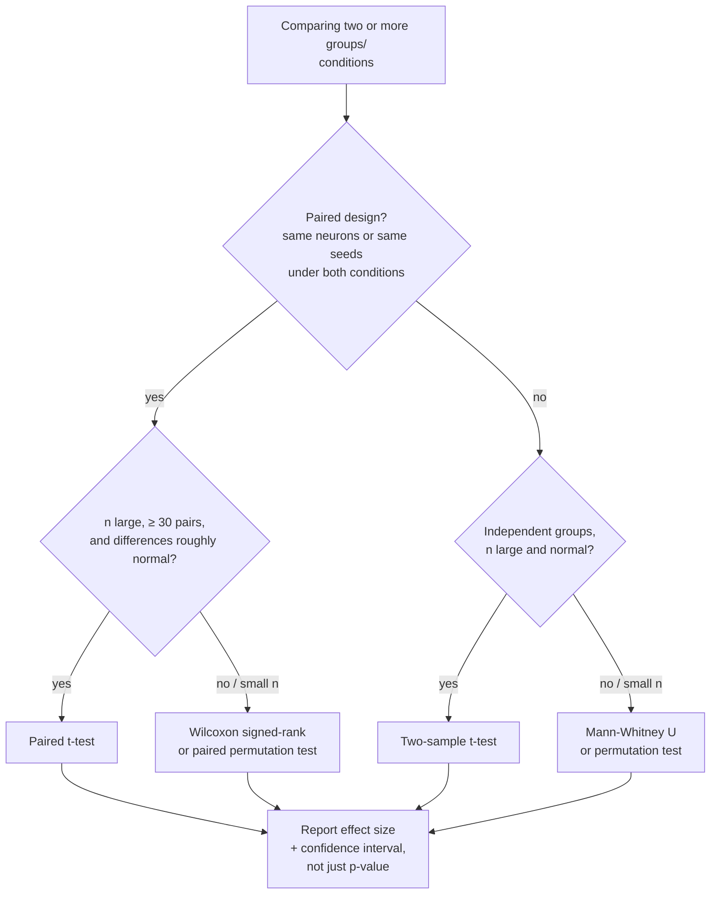

# Methods — Paper 2: Interpretability of Connectome GNNs

Audience: new contributors. This document says what exists, what is planned, which decisions are still open (and the rule that will settle them), and the hygiene rules that keep our claims honest.

## Done

- **Repository scaffolding**: `src/` (attribution, ablation, sufficiency utilities), `tests/` (synthetic graphs with planted motifs), `docs/` (this series of documents).
- **Introduction and scope**: `docs/INTRODUCTION.md` (research questions, data table, references) and `docs/EXTENDED_INTRODUCTION.md` (plain-language version).
- **Test harness**: `python -m pytest -q` runs the synthetic planted-motif tests; these verify that an attribution method recovers edges we *know* are important by construction.
- **Issue tracker**: the work plan is decomposed into five open issues (see Intended below).
- **Inherited from Paper 1** (`microns-tuning-from-wiring-benchmark`): the benchmark harness — fixed train/validation/test splits over the 12,894 coregistered neurons, the `features_mlp` baseline (R² ≈ 0.06), the trained GNN (R² ≈ 0.04), and the degree-preserving rewired-null procedure. Paper 2 treats these as **frozen inputs**; we do not retrain the benchmark here.

## Intended

| Issue | Work | Depends on |
|---|---|---|
| [#1](../../issues/1) | Implement attribution utilities with planted-motif tests | — |
| [#2](../../issues/2) | Compare attributions with known wiring rules [7,9] | #1 |
| [#3](../../issues/3) | Run attribution analysis on Paper 1 models | #1, Paper 1 artifacts |
| [#5](../../issues/5) | Motif ablation and feature-sufficiency analysis | #3 |
| [#4](../../issues/4) | Assemble results package and manuscript outline | all above |

## Planned decisions and rationale

**D1 — Attribution is multi-method by design.** No single attribution method is trustworthy alone, so every claim must survive at least two method families plus an ablation check. Rationale: gradient methods measure *sensitivity*, mask methods measure *sufficiency*, and ablation measures *effect*; agreement across all three is much harder to fake than any one number.

**D2 — Aggregation before interpretation.** Per-neuron attributions are noisy; we aggregate across neurons grouped by tuning profile before naming any motif. Rationale: a wiring *rule* is a population statement, not a single-cell statement (the like-to-like rule [7] is population-level).

**D3 — Literature comparison is a two-way test.** We check both directions: do known rules [7,9] receive high attribution, and do high-attribution motifs correspond to anything in the literature? A hit in only one direction means either the model missed biology (direction one) or the model found something artifactual or new (direction two) — very different conclusions.

## Undecided decisions (with the tie-breaking rule)

### U1 — Primary attribution method: GNNExplainer vs. integrated gradients vs. ablation-only

- **Option A — Integrated gradients:** cheap, deterministic, well understood; but it assigns credit edge-by-edge and can miss *combinatorial* motifs (a triplet where no single edge matters alone).
- **Option B — GNNExplainer-style masks:** directly returns a *subgraph*, which matches how biologists think about motifs; but it optimizes a non-convex objective per neuron, so results can be unstable and can latch onto correlated but unimportant edges.
- **Option C — Ablation-only:** most causally meaningful within the model; but combinatorially expensive over motif classes.
- **Rule:** all three run; the **primary** method is whichever achieves the best *faithfulness* on the planted-motif synthetic tests (`tests/`), measured as the correlation between attribution rank and the accuracy drop when edges are deleted in that rank order (top-1%, 5%, 20% deletion curves). **How to validate an explanation:** an explanation is only trusted if (i) deleting its top edges hurts prediction significantly more than deleting degree-matched random edges, (ii) keeping *only* its top edges retains most of the full-graph performance, and (iii) the ranking is stable across seeds (rank correlation ≥ 0.7). Failing any check, the attribution is reported as unreliable — a valid and publishable outcome given Paper 1's null.

### U2 — Distillation target for feature sufficiency

- **Option A:** distill the GNN into a linear model on motif-count features (maximally interpretable).
- **Option B:** gradient-boosted trees on the same features (more capacity, less transparent).
- **Rule:** report both; claim "sufficiency" only if the *linear* model reaches within 0.01 R² of the GNN on held-out neurons. If only the trees match, the honest statement is that the sufficient statistics are nonlinear combinations of motifs.

## Parametric vs. non-parametric decision guide

Much of Paper 2 reduces to comparisons: is the accuracy drop from ablating motif X greater than from degree-matched random ablations? Are attribution scores stable across seeds? The choice of test:

**Rules of thumb.**

1. **Small n → non-parametric.** We typically have 5–10 seeds and a handful of motif classes. With n < 30, normality cannot be verified, so default to Wilcoxon (paired) or Mann–Whitney (unpaired), or better, a **permutation test**, which makes no distributional assumption at all: shuffle the condition labels many times, recompute the difference, and ask how often shuffled differences beat the real one. Seeing Theory (https://seeing-theory.brown.edu/) has an interactive chapter on why this logic works.
2. **Paired whenever possible.** Same neurons, same seeds, same split under two conditions — always pair; it removes between-neuron variance and is the honest design here.
3. **Parametric only when earned.** t-tests are fine when n is large and residuals pass a normality sanity check; otherwise they silently assume what we cannot show.
4. **Always report effect size.** With thousands of neurons, tiny meaningless differences become "significant"; a p-value without an effect size is not a result.

## Hygiene

- **Leakage in graph splits.** Neurons share edges, so a naive random node split leaks: a test neuron's *neighbors* may be training neurons whose features were learned from. We inherit Paper 1's splits unchanged and additionally check that no attributed subgraph crosses the train/test boundary. Any motif statistic used for model selection is computed on the training portion only.
- **Seed policy.** Every reported attribution is computed across ≥ 5 model seeds (from Paper 1) and, where the method itself is stochastic (explainer masks), ≥ 5 explainer restarts. Default seeds are pinned in `src/`; any new stochastic step must take an explicit seed argument.
- **Null models.** Every attribution result is reported next to the same analysis run on the **degree-preserving rewired graph** (Paper 1's null). Because Paper 1 found the GNN insensitive to this null, our default expectation is that attributions on the rewired graph look similar — if they do, that is the headline, stated plainly.
- **Honest negative results.** Paper 1's core finding is negative (features_mlp R² ≈ 0.06 > GNN R² ≈ 0.04 on a sparse ~1.3 edges/neuron graph). Paper 2 must not spin its findings: "the GNN did not use wiring in any stable, ablation-validated way" is a first-class result, and it directly motivates Paper 4's scaling to the dense proofread graph. All attribution code must be capable of emitting a null verdict rather than forcing a motif story.
- **Artifacts and reconstruction errors.** EM reconstructions contain segmentation errors and truncated axons [3,4]. Any motif whose attribution is concentrated near volume boundaries or on low-confidence proofread segments is flagged and reported separately.

## Definition of done for each analysis

1. Passes planted-motif synthetic tests.
2. Faithfulness checks (deletion/retention/stability) reported.
3. Rewired-null comparison reported side by side.
4. Comparison against known wiring rules [7,9] included.
5. Effect sizes, seed spread, and a one-sentence plain-language verdict.
